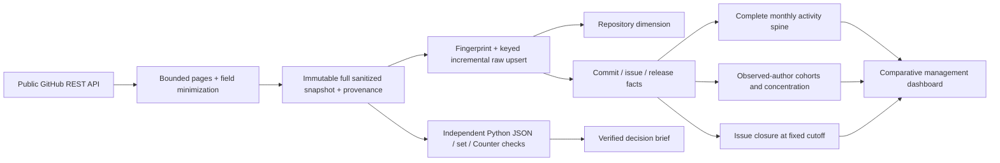

# Analytical model and metric contracts

| Relation | Grain / contract |
|---|---|
| raw repositories / dim_repository | Repository full name; snapshot metadata, not historical stars |
| raw commits / fct_commits | Repository + SHA; default-branch reachable commit, UTC committer month |
| raw issues / fct_issues | Repository + issue number, excluding PRs; 2025 creation cohort |
| raw releases / fct_releases | Repository + GitHub Release ID; stable vs prerelease separated |
| dim_month | Twelve full 2025 months |
| mart_activity | Repository × month; zero-filled, separate activity measures |
| mart_issue_closure | Repository × fixed issue creation cohort |
| mart_contributor_cohorts | Repository × first-observed author month × age month |
| mart_author_concentration | Repository × pseudonymous linked human non-merge author |

Non-merge commits are repository code-activity records, not product calls, customer usage or
individual productivity. A known human author is a non-null linked author without explicit Bot
type on a non-merge commit; co-authors are not parsed and undetected automation remains possible.
Monthly contributor counts are distinct within month; cross-month totals are not added to get
annual unique authors. Releases count published Release objects, not tags, installs or upgrades.

Issue closure requires a non-negative created-to-closed duration and closure strictly before
January 1, 2026. Unresolved includes closure after that cutoff. Seven-day closure denominators
include only requests with full potential follow-up; a close timestamp does not prove a fix.
Completed-only medians explicitly exclude unresolved issues. Project policies, issue difficulty
and repeated reporters prevent causal repository comparison. Wilson intervals summarize a
binomial model's uncertainty but independence may fail; no significance-based ranking is offered.

Observed-author cohorts are left-truncated at January 2025: first observed is not first-ever.
Only full calendar months through December are shown. NULL authors and explicit bots are excluded
from cohorts but exposed as coverage limitations in overall counts. Concentration conditions on
known human non-merge authors and cannot prove maintainer availability or operational risk.

The peak investigation compares each month's non-merge count with its previous three full
months. It selects the largest absolute increase over all eligible repository-months and examines
known author concentration. This is exploratory and does not estimate causal change or adoption.
The independent raw validator re-identifies the peak, rather than only checking its reported value.
