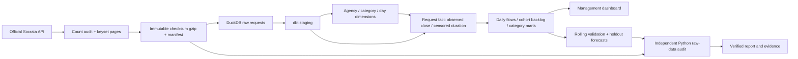

# Architecture, metric contracts and analytical decisions

| Relation | Grain | Meaning |
|---|---|---|
| raw.requests / stg_requests | unique public request ID | Seven minimized source fields; original source close retained |
| dim_agency | agency | DEP, DOT, DSNY; distinct mandates, no performance ranking |
| dim_category | agency × category hash | Category semantics owned by agency |
| dim_date | date | 91 local calendar days, zero-fill demand series |
| fct_requests | request | Historical cutoff completion, duration, censoring and quality flag |
| mart_daily | agency × day | Arrivals, valid closures, end-of-day cohort backlog |
| mart_category | agency × category × borough | Counts, completed-only percentiles and seven-day eligible denominator |

## Contracts

- Arrival cohort: created April 1, 2025 through June 30 inclusive; cutoff July 1 00:00 exclusive.
- Completion observed: valid closed_at >= created_at and closed_at < cutoff. Latest status is descriptive only.
- Unresolved: every request without such an observed closure. This includes a closure recorded after cutoff.
- Resolution duration: fractional days from created to valid observed close; NULL for unresolved cases.
- Censored duration: created to min(valid closure, cutoff); event flag is observed completion.
- Backlog: requests created before the end-of-day boundary whose valid close is absent or at/after boundary.
  It excludes earlier-than-quarter arrivals. Conservation: backlog[t] = backlog[t−1] + arrivals − closures.
- Mature seven-day completion: denominator includes only created_at+7 days <= cutoff; numerator has valid close
  within seven days and before cutoff. No denominator restricted to only completed cases.
- KM survival: product over event times of (1 − closures/at-risk), with tied censors retained until after events.
  Median is first observed time at survival <=0.5, otherwise not reached. This uses administrative-censoring assumptions.
- Forecast target: daily arrivals per agency, not closure time or staffing. Validation MAE selects model class;
  holdout MAE/WAPE evaluates it. WAPE denominator is total actual arrivals, not the mean of per-day percentages.

## Known tradeoffs

Full refresh is bounded and appropriate for a small frozen extract. The collection script can refresh the
public source automatically, but the frozen snapshot supports an inspectable, stable report. In-place source
updates cannot be made transactionally consistent by row counts alone. Closure time is an administrative
record, not necessarily resident problem resolution. Reopening history and pre-quarter backlog are absent.
Agency-case mix prevents causal comparisons. Within-agency category comparisons remain descriptive.

AI assisted design, SQL, statistical critique and writing. The source data and reported outcomes are real;
no conclusions are inserted before analysis executes. Independent raw-data calculations reduce implementation
risk but do not imply a second human reviewer. The code uses no runtime model API and no paid service.
