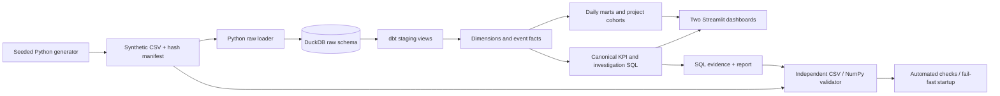

# Architecture and implementation plan

Small, local, complete. No paid services, credentials, or external runtime APIs.

Implementation sequence: research → generator → raw ingestion → dbt models/tests → canonical SQL → Streamlit → anomaly investigation → independent audit → tests, report and demonstration.

## Analytical model

| Relation | Grain | Keys / relationships |
|---|---|---|
| dim_organization | Organization | org_id; shared business dimension |
| dim_agent | Agent | agent_id → organization; fixed team/tenure |
| dim_project | Developer project | project_id → organization; fixed product, plan, signup date |
| dim_date | UTC calendar day | date_day; includes no-event days |
| fct_calls | Offered inbound call | call_id; agent_id, org_id, call_date |
| fct_api_requests | Instrumented processing attempt | request_id; project_id, request_date |
| mart_call_daily | Date × organization | Additive counts and total handling seconds |
| mart_api_daily | Date × project × product × release × organization | Additive requests, errors, processed minutes |
| mart_project_cohorts | Project × age week | Active flag, signup week, full observed week |

Call and request facts never join directly. Both can be analyzed by organization, but the sample does not imply cross-business sales attribution. Agent-to-organization consistency is tested separately from foreign keys. All joins into facts are many-to-one. Explicit staging casts define types; raw CSV preserves source fields.

This uses fixed type-1 dimensions to keep scope small; real implementations need event-time plan, team and release assignments, late-arrival policy, retry identifiers and deduplication. Source keys are unique generated synthetic IDs. A local full refresh is deliberate: there is no incremental-history claim. The period is fixed and generation is byte-reproducible under the lock file and seed. No dependency on the machine's current date.

## Reliability and reproducibility

`start.sh` installs pinned dependencies, regenerates CSV, loads raw tables, executes `dbt build`, writes SQL evidence, independently validates it, runs pytest, and serves the app only on success. `--check` runs the same pipeline without a server. CI uses the same command. Stop the app before rebuilding; DuckDB is a single local file with one build writer and read-only dashboard connections. Concurrent full refreshes are out of scope.

Data tests cover uniqueness, NULLs, accepted values, foreign keys, physical bounds, temporal consistency, fact-to-mart reconciliation, mart grain, fully observed cohorts and synthetic labels. Unit fixtures independently test denominators and percentile interpolation. Integration tests compare filtered SQL with raw pandas/NumPy calculations, recompute cohorts, verify anomaly/recovery, reject tampering, reproduce generation, and interact with both dashboards using Streamlit AppTest.

The dashboard p95 is recomputed from fact-level attempts at the selected scope. Daily marts deliberately do not store percentiles that might later be incorrectly averaged. Parameterized SQL handles all filter values; relation and column names come from fixed application code.

## Telemetry contract and scope

All organizations are `Fictional …`, all identifiers begin with `syn_`, every source row has `is_synthetic=true`, and UI/report/artifacts carry a synthetic label. No audio or customer text is collected. `translation` models a fictional API processing attempt; `voice_isolation` models a fictional instrumented SDK processing attempt. HTTP-like outcomes are normalized synthetic instrumentation, not a claim that an on-device SDK calls Krisp servers. Versions, timeouts, probabilities and processed-audio fields are invented.

Public research establishes relevant questions, not a real Krisp schema, SLA, customer metric, architecture, pricing or outcome. This project uses local dbt Core and does not demonstrate dbt Cloud operation.
